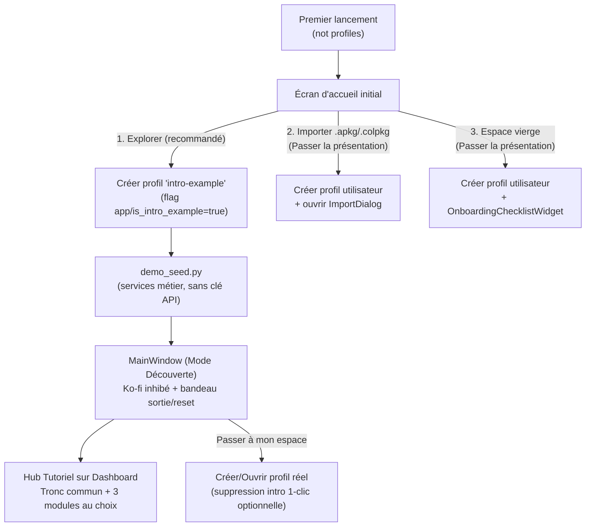

# ADR 0060 — Refonte de l'Entrée dans l'Application, Profil « Exemple d'introduction » et Tutoriel Interactif Modulaire

**Statut** : Accepté  
**Date** : 2026-11-16  
**Décideurs** : Tristan Rigaud-Humbert, Agent Antigravity  
**Contexte** : Cadrage `/grill-with-docs` issu de la refonte du ticket `Onboarding : projet bac à sable pré-indexé et mode découverte immédiate sans clé API` et du remplacement du tour guidé historique obsolète (`tour_guide.py`).

---

## Contexte & Problématique

Le parcours de premier démarrage actuel d'AnkiDraft souffre de trois ruptures majeures :
1. **Démarrage à froid silencieux (`__main__.py`)** : lorsqu'aucun profil n'existe (`not profiles`), l'application crée silencieusement un profil `"default"` vide et ouvre `MainWindow` sur un tableau de bord inerte. L'utilisateur doit configurer une clé IA ou un client MCP externe avant même de pouvoir observer les différenciateurs clés d'AnkiDraft (*Smart Coverage*, Hôpital Wozniak, Garde-Fou MCP en deux temps, revue *Batch Factory*, rendu KaTeX/Cloze).
2. **Tour guidé historique obsolète (`src/ankidraft/ui/widgets/tour_guide.py`)** : `create_default_tour_steps()` propose une visite passive de la barre latérale devant des vues vides, avec des chaînes codées en dur non internationalisées (`tr()` absent, violation de l'ADR 0013), des emojis textuels dans les titres et des libellés périmés. De plus, `app/tour_completed` est écrit mais jamais déclenché automatiquement.
3. **Interférences au démarrage (`main_window.py`)** : `_check_startup_support_dialog()` programme une popup de soutien Ko-fi 2,5 s après l'ouverture, venant interrompre la première prise en main.

---

## Décisions d'Architecture

### 1. Écran d'Accueil Initial à Trois Portes (`__main__.py`)
Lorsqu'aucun profil n'existe sur disque (`not profiles`), l'application présente un écran d'accueil dédié avant d'ouvrir un espace vide :
- **Explorer avec l'Exemple d'introduction** : crée le profil isolé `intro-example`, exécute `demo_seed.py` et ouvre `MainWindow` en mode découverte avec le tutoriel interactif.
- **Importer ma collection Anki (`.apkg` / `.colpkg`)** *(mention explicite : passe la présentation guidée)* : crée le profil réel de l'utilisateur et ouvre immédiatement `ImportDialog`.
- **Démarrer un espace vierge** *(mention explicite : passe la présentation guidée)* : crée le profil réel de l'utilisateur et ouvre le tableau de bord standard (`OnboardingChecklistWidget`, incluant un point d'entrée discret pour lancer plus tard l'*Exemple d'introduction*).

### 2. Identification Robuste & Cycle de Vie du Profil `intro-example`
- **Identifiant technique fixe + drapeau en base** : le dossier de profil porte un identifiant technique invariant (`intro-example`) et stocke `app/is_intro_example = "true"` dans `SettingModel`. Le libellé affiché à l'écran utilise `tr("Exemple d'introduction")` afin de rester compatible avec le basculement de langue FR/EN (ADR 0013).
- **Aucun profil `default` fantôme** : tant que l'utilisateur reste dans l'exemple d'introduction, aucun profil `default` vide n'est créé prématurément.
- **Bandeau Mode Découverte & Sortie en 1 clic** : un bandeau discret mais explicite signale le mode démonstration (sans clé API) et expose deux actions directes : *« Réinitialiser l'exemple »* et *« Passer à mon espace de travail »* (qui crée/sélectionne le vrai profil et propose la suppression en 1 clic de `intro-example`).
- **Sanctuarisation de la découverte** : tant que le profil actif porte `app/is_intro_example = "true"`, `_check_startup_support_dialog()` (Ko-fi) est inhibé et `OnboardingChecklistWidget` cède la place au **Hub du Tutoriel Interactif** sur `DashboardView`.

### 3. Constructeur Idempotent `demo_seed.py` via les Services Métier
- **Zéro dump SQLite figé** : les données d'introduction sont construites programmatiquement par un module `demo_seed.py` appelant exclusivement les services et dépôts métier à partir d'un mini-cours Markdown illustré embarqué dans les ressources. Cela garantit la compatibilité automatique avec toutes les migrations Peewee futures et permet de réutiliser le constructeur en mode `--dev` et en tests QA.
- **Périmètre fonctionnel complet sans clé API** :
  - 1 mini-cours Markdown structuré (avec formules LaTeX/KaTeX et 1 schéma SVG) pré-découpé en fragments (`DocumentChunkModel`) ;
  - 1 paquet d'exemple contenant ~10 notes/cartes (Basique, Cloze, KaTeX) reliées aux sections du cours (1 section verte couverte + 1 section à compléter pour *Smart Coverage*) ;
  - 2 cartes sangsues volontairement mal formulées avec `AuditRecordModel` pré-enregistré (Hôpital Wozniak) ;
  - 1 proposition `StagedPatchModel` en attente dans le Garde-Fou MCP (`CardSemanticDiffWidget`) ;
  - 1 tâche batch terminée en attente de revue humaine dans *Batch Factory* (pré-générée sans appel LLM).

### 4. Tutoriel Interactif Modulaire & Contrôleur Réactif (`InteractiveTourController`)
- **Remplacement complet de `create_default_tour_steps()`** : suppression des chaînes non traduites, des emojis textuels et de la visite passive par diaporama.
- **Architecture « Tronc commun + Modules au choix »** :
  - **Tronc commun (« L'essentiel AnkiDraft »)** : 4 à 5 étapes courtes couvrant la chaîne de valeur centrale (Sources & *Smart Coverage* → Édition KaTeX/Cloze & Hôpital Wozniak → Garde-Fou MCP Two-Phase Commit → Aperçu Export `.apkg`).
  - **3 modules thématiques optionnels au choix** accessibles depuis le Hub du Tutoriel avec suivi de complétion :
    1. *Forge & Batch Factory* (revue humaine d'une tâche batch pré-calculée) ;
    2. *Laboratoire IA* (Éditeur d'Agents, Pipelines DAG, Tests A/B) ;
    3. *Types de note & Gabarits Jinja2* (HTML/CSS, directives conditionnelles, Starter Pack).
- **Compagnon d'étape non bloquant** : remplacement de la bulle `Qt.WindowType.ToolTip` fragile (`TourBubble`) par un contrôleur réactif (`InteractiveTourController`) pilotant un compagnon d'étape non bloquant (ancré proprement et résistant à l'ouverture de modales), qui valide automatiquement l'étape via les signaux métier / navigation Qt tout en conservant un bouton *« Passer l'étape »* et *« Quitter »*.

---

## Conséquences

### Positives
- Réduction drastique du *Time-to-First-Value* : manipulation des 5 différenciateurs majeurs d'AnkiDraft dès les 30 premières secondes sans clé API ni configuration MCP préalable.
- Zéro dette de migration SQLite grâce à l'usage exclusif des services métier dans `demo_seed.py`.
- Résolution complète des défauts i18n (ADR 0013), Design System (`DESIGN.md`) et UX du tour guidé historique.

### Risques & Atténuations
- **Surcharge cognitive sur un tutoriel exhaustif** : atténuée par la scission stricte entre un tronc commun court (< 3 min) et des modules complémentaires optionnels choisis par l'utilisateur.
- **Expectation mismatch sur l'IA** : atténué par l'étiquetage transparent du bandeau *Exemple d'introduction* précisant que le jeu est pré-calculé et invitant à configurer un moteur IA ou agent MCP pour ses propres documents.
