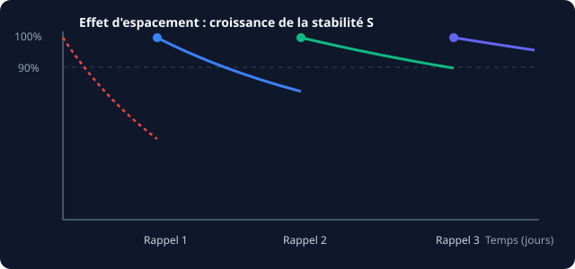

# Sciences Cognitives : Répétition Espacée et Formulation Atomique

Ce mini-cours de découverte illustre comment AnkiDraft relie vos supports de cours à vos cartes, mesure la couverture documentaire (*Smart Coverage*), audite la qualité pédagogique selon Piotr Wozniak et sécurise les modifications IA via le Garde-Fou MCP.

## 1. Principe de la répétition espacée

La **répétition espacée** consiste à planifier chaque révision juste avant le moment probable de l'oubli. Contrairement au bachotage massif, l'espacement progressif des rappels force le cerveau à effectuer un effort de récupération actif (*active recall*), ce qui consolide la trace mnésique à long terme.

L'**effet de test** (*testing effect*) démontre que se tester activement produit une rétention nettement supérieure à la relecture passive. Chaque rappel réussi augmente la stabilité de la mémoire et permet d'allonger l'intervalle suivant sans perdre en précision.

## 2. Modèle mathématique de rétention et stabilité

Dans les modèles exponentiels et de type loi de puissance utilisés pour modéliser l'oubli, la probabilité de rappel $R(t)$ décroît en fonction du temps écoulé $t$ depuis la dernière révision et de la stabilité $S$ de la trace mémorielle :

$$R(t) = e^{-\frac{t}{S}}$$

Plus la stabilité $S$ est élevée, plus la courbe décroît lentement : lorsqu'on fixe une rétention cible $R_{\text{cible}} = 0{,}90$, l'intervalle optimal $I$ s'obtient directement par inversion de la formule :

$$I = -S \cdot \ln(R_{\text{cible}})$$

Dans la pratique, chaque carte possède une difficulté intrinsèque et une stabilité qui évoluent indépendamment après chaque notation de l'utilisateur dans Anki.

## 3. Interférence sémantique et atomicité des cartes

Selon les 20 règles de formulation de Piotr Wozniak, l'**information minimale** (atomicité) est la règle la plus déterminante pour éviter les cartes sangsues (*leeches*). Une carte contenant plusieurs faits indépendants ou une énumération longue génère une charge cognitive excessive et provoque des échecs répétés.

L'**interférence sémantique** survient lorsque deux notions proches partagent des indices ambigus : il convient alors d'ajouter un contexte discriminant explicite ou de scinder la note en questions courtes, univoques et autonomes afin de maintenir un taux de réussite élevé lors des révisions quotidiennes.
