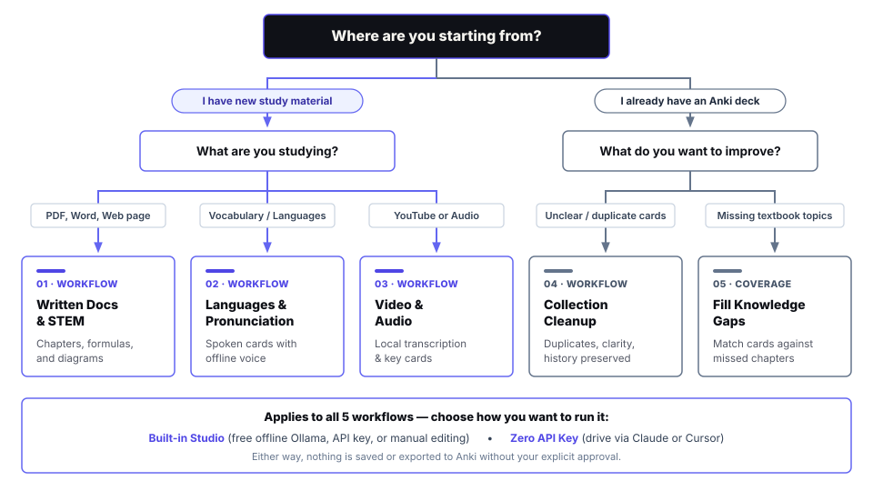

This guide walks you through creating your first Anki flashcard deck in minutes and helps you pick the end-to-end workflow that matches your study material and AI setup.

## Which workflow fits your goal?

Jump straight to the recipe built for your use case:

1. **[Medicine & STEM: Dense PDFs, KaTeX Math, and Diagrams](/en/workflows/medecine-sciences-pdf/)** — scope textbook chapters, extract formulas and figures, and audit against Wozniak rules (Studio or MCP).
2. **[Languages & Audio: Vocabulary and Offline TTS Pronunciation](/en/workflows/langues-et-audio-tts/)** — add natural offline Kokoro or Piper voice audio and fix ambiguous cards via MCP.
3. **[YouTube Video & Audio Lectures: Transcription and Extraction](/en/workflows/cours-video-youtube-audio/)** — transcribe recorded lectures with Whisper or subtitles and turn key segments into cards.
4. **[Zero API Key Workflow with an External MCP Agent](/en/workflows/zero-cle-api-agent-mcp/)** — drive AnkiDraft directly from Claude Desktop, Claude Code, Cursor, or Antigravity without extra API costs.
5. **[Anki Collection Rescue & Hygiene (Studio & MCP)](/en/workflows/sauvetage-et-hygiene-anki-mcp/)** — import your `.colpkg` safely, eliminate duplicates and leeches, run MCP audit campaigns, and export back without losing SRS history.

## Built-in Creation Studio vs. External MCP Agent

AnkiDraft works either standalone in the Creation Studio or connected to your existing AI assistant over MCP.

| Dimension | Built-in Creation Studio | External Agent via MCP Server |
| :--- | :--- | :--- |
| **AI setup required** | Free local model (Ollama) or API key (OpenAI, Gemini, Claude) | Existing plan (Claude Desktop/Code, Cursor, Antigravity) — **zero API key** |
| **Interaction style** | Visual chapter picker, prebuilt DAG pipelines, one-click tools | Natural conversation in your AI client connected on port `8765` |
| **Best suited for** | Batch PDF extraction, bulk TTS generation, visual KaTeX editing | Cross-deck gap audits, multi-step hygiene campaigns, note-type refactoring |
| **Human control** | **Staging Review** queue before saving | **Safeguard (Two-Phase Commit)**: nothing changes until you click **Apply** |

## The 4-Step Core Flow (Studio)

### Step 1: Select or Create Your Profile

On first launch, AnkiDraft opens the `default` profile. To keep subjects isolated (e.g., *Medicine*, *Languages*), click the profile selector at the bottom of the sidebar to create a dedicated workspace.

### Step 2: Configure an AI Provider (Optional)

Open **Settings** (<kbd>Ctrl+,</kbd>) and switch to **AI Engines**:
- **100% free & offline**: install [Ollama](/en/ai-setup/local-models-ollama/) locally and choose a model.
- **Cloud API key**: enter your OpenAI, Google Gemini, or Anthropic Claude key (stored in your OS encrypted keychain).
- **Zero API key**: enable the [Local MCP Server](/en/workflows/zero-cle-api-agent-mcp/) to work with Claude or Cursor.

### Step 3: Import Your First Document

1. Open the **My Documents** view (<kbd>Alt+7</kbd>) from the sidebar.
2. Drag and drop a PDF, Word, PowerPoint, or EPUB file, or paste a YouTube lecture URL.
3. Select the chapters you want to study, then switch to **Creation Studio** (<kbd>Alt+2</kbd>) and click **Generate** (or **Forge Section**).

### Step 4: Validate and Export to Anki

Review generated cards, run the [Wozniak Quality Audit](/en/cards/linter_wozniak/) (<kbd>Alt+4</kbd>), then press <kbd>Ctrl+Alt+E</kbd> (**Export Anki Cards (.apkg)**). Double-click the exported `.apkg` file to add your cards directly into Anki for daily spaced-repetition review.

> Want plain-language definitions with concrete Before / After examples? Read the [User Glossary](/en/guides/glossaire/).
