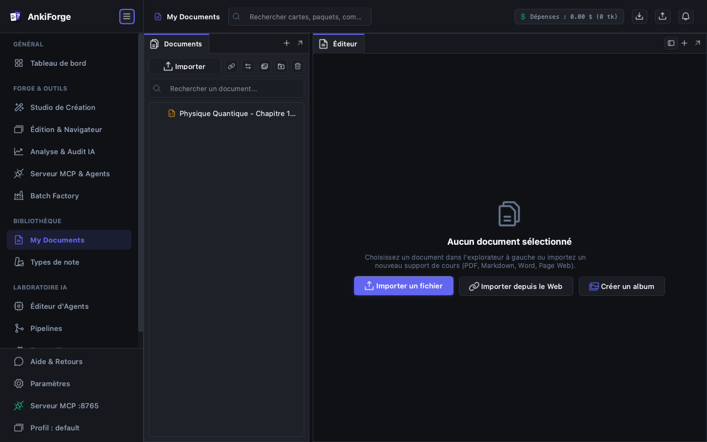
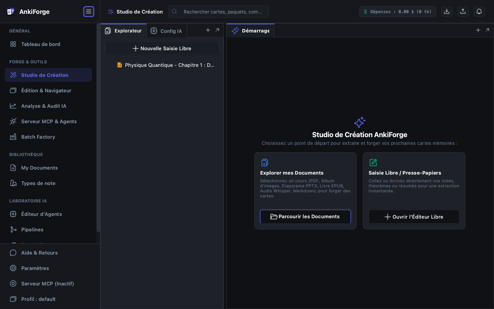

Recorded university lectures, YouTube explainers, and seminar audio files pack hours of spoken insight that are slow to review manually. This workflow turns speech into structured, atomic flashcards.

## 1. Import a YouTube URL or Local Audio Recording

1. Open **My Documents** (<kbd>Alt+7</kbd>).
2. Choose your source type ([Import YouTube & Audio](/en/sources/import-youtube-audio/)):
   - **YouTube lecture**: click **Import from Web** and paste the video URL. AnkiDraft downloads official captions when present or falls back to local speech-to-text transcription.
   - **Recorded lecture or voice memo** (`.mp3`, `.wav`, `.m4a`, `.mp4`, `.ogg`): drag and drop the file into **My Documents**. Local **Whisper** transcription runs on your machine without uploading your recordings to third-party servers.

## 2. Turn Raw Transcripts into Structured Study Sections

Spoken transcripts naturally contain filler words, tangents, and broken sentences. Clean and outline the transcript before drafting flashcards:

- **In Creation Studio**: run a [DAG Pipeline](/en/cards/dag_et_rag/) with an upstream Markdown synthesis step before card extraction.
- **Via an MCP Agent**: ask Claude or Cursor to call `structure_transcript_for_ai` followed by `structure_document_sections` so timestamped speech becomes a crisp, hierarchical outline.

## 3. Slice by Topic and Generate Cards

1. Switch to **Creation Studio** (<kbd>Alt+2</kbd>) or the **Batch Slice Composer** to process one thematic segment at a time.
2. Pick your note type (*Basic* or *Cloze*) and domain persona ([AI Card Generation](/en/cards/ai-generation/)).
3. Review every draft in **Staging** to catch spoken ambiguities or misheard technical terms before saving.

## 4. Automate Structuring and Drafting via MCP

When driving AnkiDraft from Claude Code, Claude Desktop, or Cursor on port `8765` with zero extra API key:

- **MCP tools used**: `structure_transcript_for_ai`, `get_document_outline`, `create_notes_batch`, `begin_staged_bundle`, `commit_staged_bundle`.
- **Sample prompt**: *"Clean up raw transcript document #9 using `structure_transcript_for_ai` (didactic profile, keep timestamps), then stage atomic definitions and causal questions via `create_notes_batch` into deck `Lectures::Neuroscience` for Safeguard review."*
