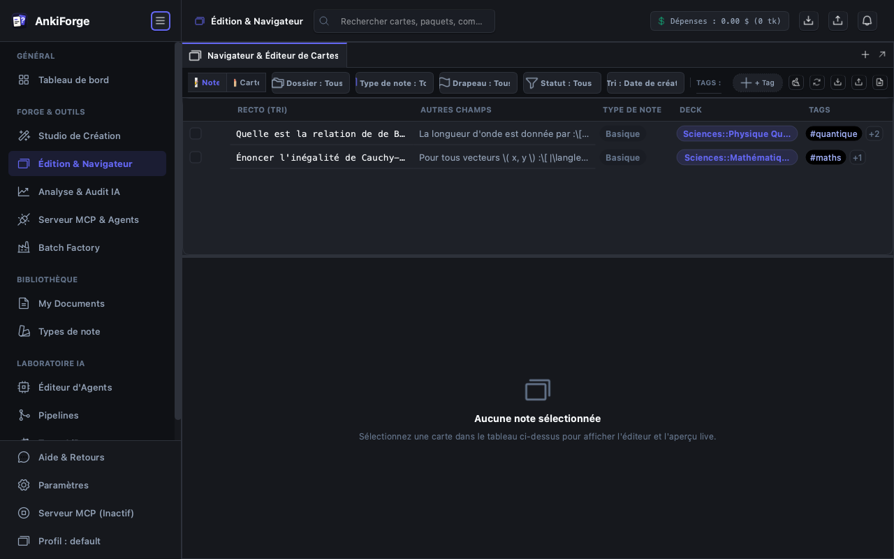

This workflow shows how to build language decks (Japanese, Spanish, French, German, Mandarin, and more) with contextual sentence examples and 100% offline pronunciation audio.

## 1. Bring In Your Vocabulary List or Study Material

You can start from any of three sources:
- A **source document** (grammar handout, vocabulary sheet, article, or subtitle file dropped into **My Documents**).
- An **existing Anki deck** imported with <kbd>Ctrl+Shift+I</kbd> ([Import .apkg / .colpkg](/en/anki-sync/import-colpkg/)).
- **Direct entry** inside **Editor & Browser** (<kbd>Alt+3</kbd>).

For higher long-term retention, prefer a **short contextual sentence** on the front card highlighting the target word rather than an isolated one-word translation.

## 2. Download Voice Modules and Generate Pronunciation Audio

To keep the initial installer lightweight, the offline neural TTS engines (**Piper** and **Kokoro**) are not bundled by default — you download only what you need in one click ([Text-to-Speech & Audio](/en/cards/audio-tts/)).

### Step A — Install Offline Voice Modules (Piper or Kokoro)

1. Open **Settings** (<kbd>Ctrl+,</kbd>) › **Audio & TTS**.
2. Pick your engine setup:
   - **Piper TTS (recommended offline)**: expand **MOTEUR LOCAL PIPER**, click **Download Piper CLI (1-Click)**, then pick the voice pack for your target language under **Additional Voices** and click **Download**.
   - **Kokoro-82M (optional high-fidelity offline)**: expand **MOTEUR LOCAL KOKORO-82M (OPTIONNEL)** and click **Install Kokoro (1-Click)** (plus **Download Kokoro Models** if prompted).
   - **Zero setup**: use **Edge-TTS** (free neural voices requiring internet, no API key) or your **OS System Engine** (native voices already installed on your machine).
3. Under **Synthesis Engine**, select the installed engine (**Piper TTS**, **Kokoro-82M**, **Edge-TTS**, or **OS System**), choose the default voice, and click **Test Selected Voice**.

:::note
Downloaded voice modules live locally inside AnkiDraft's tools directory (`tools/tts/piper` and `tools/tts/kokoro`). Once installed, audio generation runs **100% offline**.
:::

### Step B — Attach Audio to Your Cards

1. **Single-card audio**: in **Editor & Browser** (<kbd>Alt+3</kbd>), click inside the target-language field and press the **TTS / speaker** icon to generate and preview `[sound:tts_xxx.mp3]` right away.
2. **Batch deck audio**: select multiple notes in the browser and trigger **Batch TTS Generation** to add missing audio clips in the background.

## 3. Enrich and Clean Up Language Decks with Claude or Cursor (Zero API Key)

A common issue in language decks is mixing two languages in one prompt or pairing literal translations with no natural context. Your assistant connected in [zero API key mode](/en/workflows/zero-cle-api-agent-mcp/) can clean up an entire deck safely:

- **Add audio across an entire language deck**:
  - Tools used: `get_cards_by_deck_or_tag`, `generate_card_audio`, `generate_cards_batch_audio`.
  - Sample prompt: *"Fetch notes in deck `Languages::Japanese` (with `recursive=True`) missing `[sound:...]` tags and run `generate_cards_batch_audio` on the Expression field using a Japanese voice."*
- **Fix mixed-language prompts and add natural example sentences**:
  - Tools used: `diagnose_domain_knowledge_gaps`, `propose_card_refactor`.
  - Sample prompt: *"Inspect `Languages::Spanish` with `diagnose_domain_knowledge_gaps`, find cards mixing two languages or overloading synonyms, and stage clean contextual rewrites via `propose_card_refactor`."*

## 4. Export with Your Audio Files

Press <kbd>Ctrl+Alt+E</kbd> to export your `.apkg`: AnkiDraft packages deduplicated audio files automatically so playback works smoothly on Anki Desktop, AnkiWeb, and AnkiMobile.
