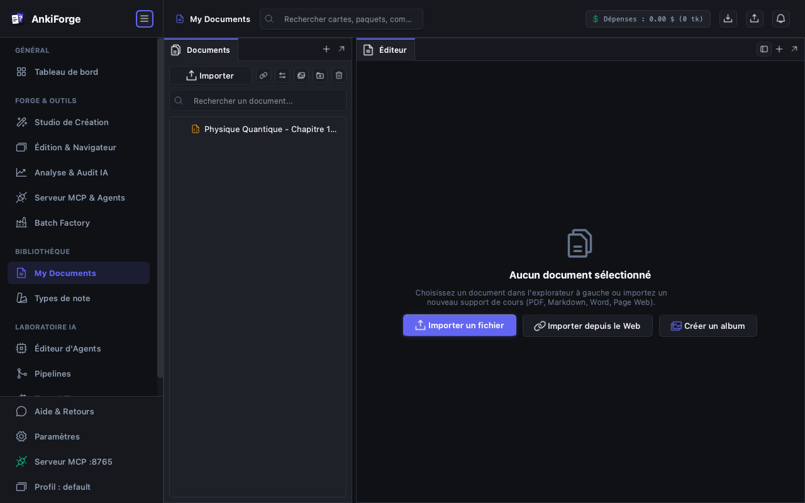

This workflow shows how to turn dense university handouts or STEM textbooks (medicine, law, physics, calculus) into short, clear flashcards faithful to your source material, complete with math formulas and labeled diagrams.

## 1. Import the PDF with Figure and Equation Extraction

1. Open **My Documents** (<kbd>Alt+7</kbd>) and click **Import File** (or drag and drop your `.pdf`).
2. Pick the extraction engine matching your file:
   - **Fast standard extraction** for clean digital PDFs without complex mathematical notation.
   - **Advanced OCR (Marker)** for scanned handouts, multi-column layouts, tables, and mathematical equations.
3. Extracted figures and diagrams are saved automatically to your local media library. See [Import PDFs, Slides, and Ebooks](/en/sources/import-pdf/) for details.

## 2. Skip Unneeded Pages Without Deleting Source Content

A 200-page course pack usually contains a preface, table of contents, and bibliography that distort generation and progress tracking.

In the [Scope & Chapter Selector](/en/sources/scope-and-slices/):
- **Exclude** appendices, acknowledgments, and bibliographies: AI generation skips them while the original text remains readable.
- **Neutralize** the table of contents or cover pages: they are removed from your coverage gauge so your progress stays accurate.

## 3. Generate Clear Cards and Edit Math or Diagrams

1. To draft interactively from one chapter or excerpt, open **Creation Studio** (<kbd>Alt+2</kbd>). To process multiple chapters or an entire textbook in a queue, switch to **Batch Factory** (<kbd>Alt+6</kbd>) and click **Batch Slice Composer** (<kbd>Ctrl+N</kbd>).
2. Pick the target note type (*Basic*, *Cloze*, or *Image Occlusion*) and destination deck (e.g., `Medicine::Cardiology`).
3. In **Editor & Browser** (<kbd>Alt+3</kbd>), verify live math rendering, turn key terms into cloze deletions with <kbd>Ctrl+Shift+C</kbd> (<kbd>Cmd+Shift+C</kbd> on macOS), or mask diagram labels ([Notes Editor & KaTeX](/en/cards/editeur_notes_katex/)).

## 4. Check Card Clarity Before Export

Open **Analysis & AI Audit** (<kbd>Alt+4</kbd>) to run the [clarity check](/en/cards/linter_wozniak/): overly long cards or prompts testing multiple concepts at once are flagged for one-click splitting before exporting via <kbd>Ctrl+Alt+E</kbd> ([Export .apkg](/en/anki-sync/export-apkg/)).

## 5. Drive This Workflow with Claude or Cursor (Zero API Key)

Prefer steering your exam prep from Claude Desktop, Claude Code, or Cursor? Turn on the local connector under **MCP Server & Agents** (<kbd>Alt+5</kbd>) and use these examples:

- **Clean document scope before drafting**:
  - Tools used: `get_document_outline`, `exclude_document_region`, `neutralize_document_region`.
  - Sample prompt: *"Read the outline of document #4, neutralize the table of contents and exclude the bibliography, then list the active chapters."*
- **Find missed concepts across decks and draft missing cards**:
  - Tools used: `diagnose_domain_knowledge_gaps`, `search_document`, `create_notes_batch`.
  - Sample prompt: *"Run `diagnose_domain_knowledge_gaps` on the Action Potential chapter of my Physiology course across all decks, list missing concepts, and stage short KaTeX flashcards `\( ... \)` for my approval."*

> Every proposal from Claude or Cursor waits for your click on **Apply** before touching your collection.
