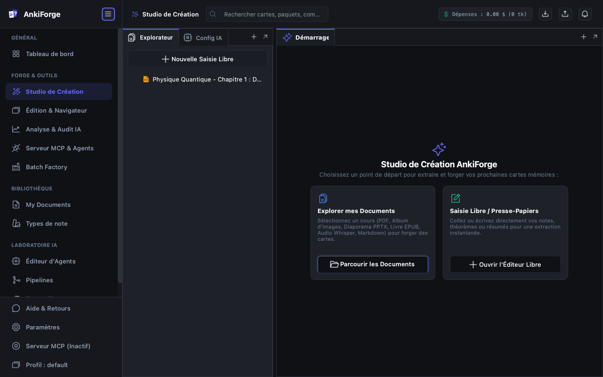
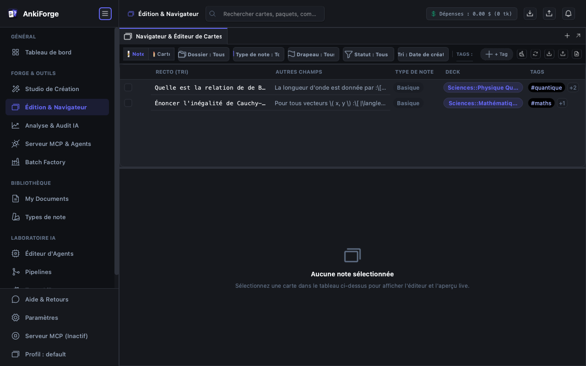

This workflow shows how to turn dense university handouts or STEM textbooks (anatomy, physiology, physics, calculus) into atomic flashcards faithful to your source material, complete with KaTeX equations and labeled diagrams.

## 1. Import the PDF with Figure and Equation Extraction

1. Open **My Documents** (<kbd>Alt+7</kbd>) and click **Import File** (or drag and drop your `.pdf`).
2. Pick the extraction engine matching your file:
   - **Fast standard extraction** for clean digital PDFs without complex mathematical notation.
   - **Advanced OCR (Marker)** for scanned handouts, multi-column layouts, tables, and formulas converted into native LaTeX (`\(...\)` and `\[...\]`).
3. Extracted figures and anatomical plates are saved automatically to your local media library. See [Import PDFs, Slides, and Ebooks](/en/sources/import-pdf/) for details.

## 2. Scope Useful Chapters Without Deleting Source Pages

A 200-page course pack usually contains a preface, table of contents, and bibliography that distort generation and coverage tracking.

In the [Scope & Chapter Selector](/en/sources/scope-and-slices/):
- **Exclude** appendices, acknowledgments, and bibliographies: AI generation skips them while the original text remains intact.
- **Neutralize** the table of contents or cover pages: they are removed from your *Smart Coverage* denominator so your progress gauge stays accurate.

## 3. Generate Atomic Cards and Edit Math or Occlusions

1. Switch to **Creation Studio** (<kbd>Alt+2</kbd>) or open the **Batch Slice Composer** to split your selection by chapter.
2. Pick the target note type (*Basic*, *Cloze*, or *Image Occlusion*) and destination deck (e.g., `Medicine::Cardiology`).
3. In **Editor & Browser** (<kbd>Alt+3</kbd>), verify live KaTeX math rendering, turn key terms into cloze deletions with <kbd>Ctrl+Shift+C</kbd> (<kbd>Cmd+Shift+C</kbd> on macOS), or mask diagram labels ([Notes Editor & KaTeX](/en/cards/editeur_notes_katex/)).

## 4. Run a Wozniak Quality Check Before Export

Open **Analysis & AI Audit** (<kbd>Alt+4</kbd>) to run the [Wozniak Quality Linter](/en/cards/linter_wozniak/): overloaded cards or multi-concept prompts are flagged for one-click splitting before exporting via <kbd>Ctrl+Alt+E</kbd> ([Export .apkg](/en/anki-sync/export-apkg/)).

## 5. Drive This Workflow via MCP (Claude, Cursor, Antigravity)

Prefer steering your exam preparation from Claude Desktop, Claude Code, or Cursor with zero extra API keys? Enable the local MCP server under **MCP Server & Agents** (<kbd>Alt+5</kbd>) and use these patterns:

- **Clean document scope before drafting**:
  - Tools used: `get_document_outline`, `exclude_document_region`, `neutralize_document_region`.
  - Sample prompt: *"Read the outline of document #4, neutralize the table of contents and exclude the bibliography, then list the active chapters."*
- **Find coverage gaps across decks and draft missing cards**:
  - Tools used: `diagnose_domain_knowledge_gaps`, `search_document`, `create_notes_batch`.
  - Sample prompt: *"Run `diagnose_domain_knowledge_gaps` on the Action Potential chapter of my Physiology course across all decks, list Type 1 missing concepts, and stage atomic KaTeX flashcards `\( ... \)` for Safeguard review."*

> Every mutation proposed by an external MCP agent lands in the **Safeguard** review queue before touching your collection.
