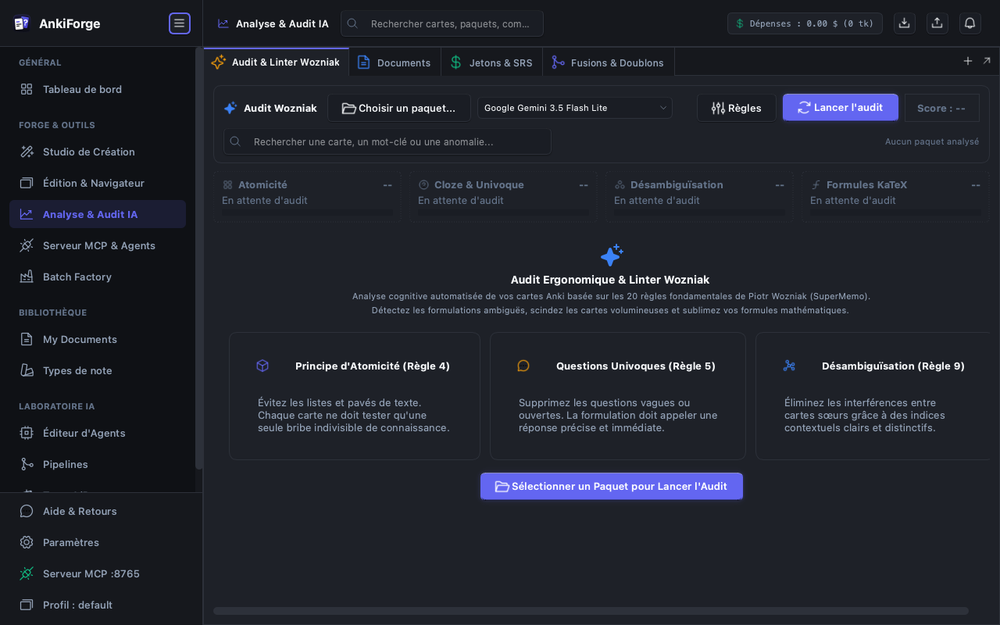
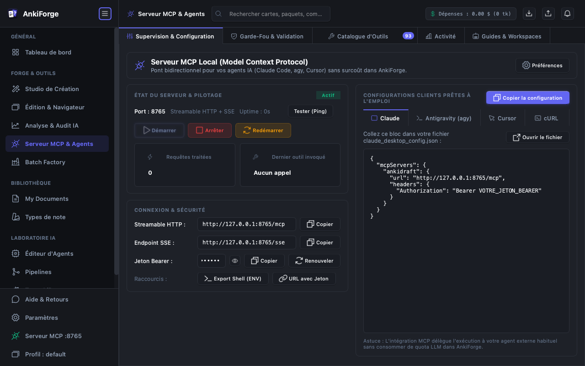

Stuck with an older Anki deck (your own or a shared deck) full of cards you keep forgetting, near-duplicates, messy tags, or bloated paragraphs? This workflow helps you clean up a single deck or your whole collection without ever losing your review history and progress in Anki.

## 1. Safely Import Your Deck (`.apkg`) or Collection (`.colpkg`)

Pick the format that matches what you want to audit:

- **Option A — A single deck or shared deck (`.apkg`)**: best when you want to inspect or clean **one specific deck** (a deck downloaded from AnkiWeb, shared by a classmate, or exported individually from Anki Desktop via **File > Export > Anki Deck Package (`.apkg`)** — check *Include scheduling information* if you also want flags and lapse counts imported). Importing an `.apkg` **merges that deck without touching other decks** already in your AnkiDraft profile.
- **Option B — Your entire Anki collection (`.colpkg`)**: best when cleaning **all your decks at once** and syncing cards you deleted in Anki: from Anki Desktop, export **File > Export > Anki Collection Package (`.colpkg`)** including media and scheduling info. AnkiDraft automatically creates a backup snapshot and keeps your study documents separate from your Anki cards.

In AnkiDraft, press <kbd>Ctrl+Shift+I</kbd> and drop your `.apkg` or `.colpkg` file ([Import .apkg or .colpkg](/en/anki-sync/import-colpkg/)).

## 2. Spot Duplicates and Overloaded Cards

1. Open **Analysis & AI Audit** (<kbd>Alt+4</kbd>).
2. Under **Audit & Wozniak Linter**, pick a deck and click **Run Audit**: overly long, vague, or multi-concept cards receive clear suggestions ([Improve card clarity](/en/cards/linter_wozniak/)).
3. Open **Merges & Duplicates** to spot near-identical notes and merge duplicates cleanly.

## 3. Clean Up an Entire Deck with Claude or Cursor (Zero API Key)

To clean hundreds of cards across multiple decks quickly, connect Claude, Cursor, or Antigravity under **MCP Server & Agents** (<kbd>Alt+5</kbd>), open your agent workspace (`~/ankiforge_agentique` from **Guides & Workspaces**) so your **cleanup Skills** load automatically, and follow these four stages:

### Stage A — Fix Cards Flagged During Daily Reviews
While reviewing in Anki, flag painful cards (Red = split needed, Orange = fact-check), then re-import your `.apkg` (with scheduling included) or `.colpkg` into AnkiDraft:
- **Skills triggered**: `refactorisation-cartes`, `chasse-sangsues` (`get_flagged_cards`, `get_note_full_profile_360`, `set_card_flag`).
- **Prompt**: *"Fetch all my red-flagged cards and recent leeches, diagnose why they keep failing, and stage shorter card rewrites for each."*

### Stage B — Find Missed Topics, Duplicates, and Overloaded Cards
- **Skills triggered**: `audit-qualite`, `deduplication-consolidation`, `audit-couverture-rag` (`diagnose_domain_knowledge_gaps`, `find_duplicate_cards`).
- **Prompt**: *"Analyze Renal Physiology across all my decks: surface related isolated cards, clear duplicates to merge, and missing or overloaded concepts."*

### Stage C — Clean Up Tags and Empty Cards
- **Skill triggered**: `hygiene-taxonomie-tags` (`audit_tag_hygiene`, `merge_tag_clusters`, `list_empty_cards`, `delete_empty_cards`).
- **Prompt**: *"Audit tag consistency, stage merges for near-duplicate typo or plural tags, and check for any cards with an empty front."*

### Stage D — Batch Split and Rewrite with Approval
- **Skill triggered**: `amelioration-deck` (`begin_staged_bundle`, `propose_card_split`, `propose_card_refactor`, `commit_staged_bundle`).
- **Prompt**: *"Stage a grouped cleanup bundle that splits the 8 cards exceeding 40 words into 2–3 short cards each and tightens vague prompts for review."*

## 4. Approve and Export Back Without Losing Progress

1. Open **MCP Server & Agents** (<kbd>Alt+5</kbd>) > **Safeguard & Validation** and review every Before / After change visually.
2. Click **Apply** to save the bundle into AnkiDraft.
3. Export the cleaned deck via <kbd>Ctrl+Alt+E</kbd> (or `export_deck_apkg`) and open the `.apkg` in Anki: thanks to stable note IDs and [Smart Merge](/en/anki-sync/synchro_smart_merge/), updated wording lands cleanly while preserving your review progress.
