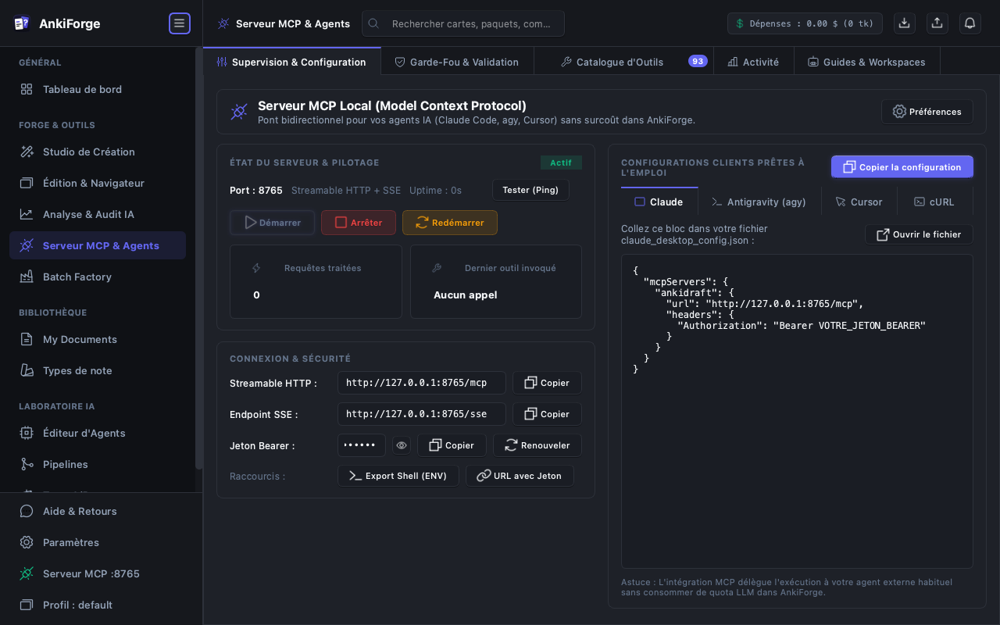

Already using **Claude Desktop**, **Claude Code**, **Cursor**, **Windsurf**, or **Antigravity (`agy`)**? AnkiDraft pairs a local MCP server with an **agent workspace** (`~/ankiforge_agentique`) so you can generate flashcards, audit courses, and clean up decks with **zero additional API keys**. Every change waits for your manual approval before being saved.

## 1. Enable the Local Server and Agent Workspace

1. Open **MCP Server & Agents** (<kbd>Alt+5</kbd>) from the sidebar.
2. Under **Supervision & Configuration**, verify the server is active on port `8765` (or click **Start**), then copy the ready-to-use snippet for **Claude**, **Antigravity (agy)**, **Cursor**, or **cURL**.
3. Switch to **Guides & Workspaces** to verify your agent workspace (`~/ankiforge_agentique` by default) with **Check Drift** (or create it via **Initialize Workspace**).
4. Open that folder in Claude Code, Cursor, or Antigravity: your assistant reads `AGENT.md`, `.agents/active-profile.md`, and `.agents/mcp-catalog.md` to discover your active profile and the **93 MCP tools** ([MCP Server & Workspaces guide](/en/ai-setup/consultant_mcp/)).

## 2. Five Everyday Prompts Using MCP Tools

With the workspace open, write natural requests — your assistant picks the right MCP tools and routes mutations through Safeguard:

### Case A — Sync Context & Get a Collection Overview
- **Key MCP tools**: `sync_agent_workspace`, `audit_workspace_drift`, `list_decks`, `list_documents`, `get_flagged_cards`.
- **Prompt**: *"Verify and sync the workspace with my active AnkiDraft profile, then give me an overview of my decks, flagged cards, and imported study documents."*

### Case B — Create Cards from a Structured Lecture
- **Key MCP tools**: `get_document_outline`, `search_document`, `create_notes_batch`, `begin_staged_bundle`, `commit_staged_bundle`.
- **Prompt**: *"Read the glycemic regulation sections of document #3, draft 12 short KaTeX flashcards in deck `Biochemistry::Metabolism`, and send the staged bundle to Safeguard."*

### Case C — Spot Concepts Missing Between Course and Deck
- **Key MCP tool**: `diagnose_domain_knowledge_gaps`.
- **Prompt**: *"Run `diagnose_domain_knowledge_gaps` on my Immunology textbook across all decks, list missing or non-atomic concepts, and stage cards to close the coverage gaps."*

### Case D — Modernize Card Templates and Dark-Mode CSS
- **Key MCP tools**: note type inspection & proposal tools (*Tool Catalog* › *Note Types*).
- **Prompt**: *"Inspect `Medical Cloze` fields, improve hint contrast in dark mode, and stage the template update for my review."*

### Case E — Clean Up Failing Cards, Duplicates, and Tags
- **Key MCP tools**: `get_flagged_cards`, `find_duplicate_cards`, `propose_card_split`, `propose_card_refactor`, `audit_tag_hygiene`.
- **Prompt**: *"Pull my red-flagged cards, split dense cards into shorter ones, detect duplicates, and stage a reviewable cleanup bundle."* (See [Anki Collection Rescue & Hygiene](/en/workflows/sauvetage-et-hygiene-anki-mcp/)).

:::tip
To automate repeatable multi-step extractions, your assistant can also trigger your saved [DAG & RAG Pipelines](/en/cards/dag_et_rag/) via `list_pipelines` and `trigger_pipeline_run`.
:::

## 3. Review and Approve Before Saving

No card is ever modified behind your back:
1. Open **Safeguard & Validation** under **MCP Server & Agents** (<kbd>Alt+5</kbd>).
2. Review the **Before / After diff**, explanation for each proposal, and deletion or split impact (individually or grouped in a **Staged Bundle**).
3. Click **Apply** to save into AnkiDraft, or **Reject proposal** / **Reject all** to discard cleanly.
