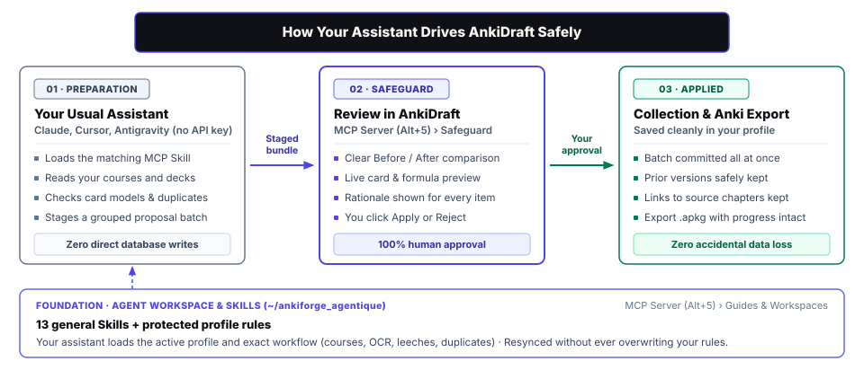

# Zero API Key Workflow: Drive AnkiDraft from Claude or Cursor

Already using **Claude Desktop**, **Claude Code**, **Cursor**, or **Antigravity**? Through AnkiDraft's built-in **MCP (Model Context Protocol)** server, you can draft flashcards, audit coverage gaps, and clean up decks with **zero additional API keys** while keeping every edit behind the **Safeguard**.

## 1. Start the Local MCP Server and Copy Client Config

1. Open **MCP Server & Agents** (<kbd>Alt+5</kbd>) from the sidebar.
2. Confirm the local server shows **Active** on port `8765` (or click **Start**).
3. Under **Ready-to-Use Client Configurations** on the right, pick your client (**Claude**, **Antigravity**, **Cursor**, or **cURL**) and click **Copy Configuration** (or **Open File**).
4. Paste the JSON snippet (`http://127.0.0.1:8765/mcp` plus your Bearer token) into your AI client config and restart it.

## 2. Five Concrete MCP Use Cases (Copy-Paste Prompts)

### Case A — Generate Course-Grounded Flashcards by Chapter
- **MCP tools**: `search_document`, `get_document_outline`, `begin_staged_bundle`, `create_notes_batch`, `commit_staged_bundle`.
- **Prompt**: *"Inspect the outline of document #3, read the sections on glycemic regulation with `search_document`, then stage a grouped bundle (`begin_staged_bundle` + `create_notes_batch` + `commit_staged_bundle`) of 12 atomic KaTeX flashcards in deck `Biochemistry::Metabolism`."*

### Case B — Store an External Summary as an Authoritative Source
- **MCP tools**: `write_mcp_artifact`, `ingest_authority_source`, `reindex_document`.
- **Prompt**: *"Write a clean Markdown synthesis of adaptive immunity from my lecture notes, save it with `write_mcp_artifact`, and ingest it with `ingest_authority_source` so newly generated cards keep section-level provenance links."*

### Case C — Create or Modernize Note Types and Card CSS
- **MCP tools**: `list_note_types`, `get_note_type_details`, `propose_note_type_refactor`, `propose_css_tune`, `preview_card_render`.
- **Prompt**: *"Inspect the `Medical Cloze` note type via `get_note_type_details`, improve hint contrast in dark mode with `propose_css_tune`, check the output using `preview_card_render`, and stage `propose_note_type_refactor` for Safeguard approval."*

### Case D — Run a DAG Pipeline in Delegated MCP Mode
- **MCP tools**: `list_pipelines`, `trigger_pipeline_run`, `provide_pipeline_step_content`.
- **Prompt**: *"List my pipelines via `list_pipelines`, start pipeline #2 in delegated mode with `trigger_pipeline_run`, supply each paused step output via `provide_pipeline_step_content`, and send the resulting cards to the Safeguard."*

### Case E — Clean Up and Refactor Existing Decks
- **MCP tools**: `get_flagged_cards`, `diagnose_domain_knowledge_gaps`, `propose_card_split`, `propose_card_refactor`.
- **Prompt**: *"Fetch my red-flagged cards with `get_flagged_cards` and split dense cards into atomic prompts with `propose_card_split`."* (See [Anki Collection Rescue & MCP Hygiene](/en/workflows/sauvetage-et-hygiene-anki-mcp/)).

## 3. Review and Approve in the Safeguard (Two-Phase Commit)

Nothing is written behind your back:
1. Open the **Safeguard & Validation** sub-tab under **MCP Server & Agents** (<kbd>Alt+5</kbd>).
2. Review the **Before / After semantic diff**, live HTML/KaTeX card preview, and deletion or split impact.
3. Click **Apply** to commit the bundle atomically into SQLite, or **Reject** to discard every change cleanly.
