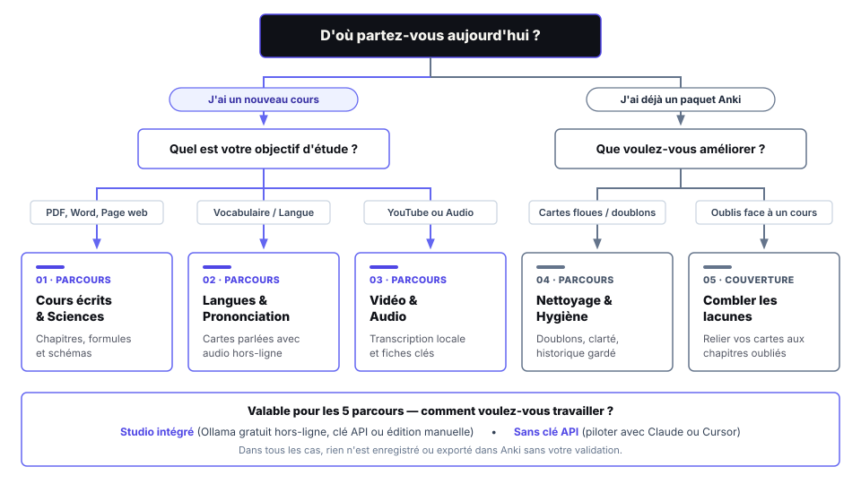

Ce guide vous permet de produire votre premier paquet de flashcards Anki en quelques minutes et de choisir le parcours exact correspondant à votre matière et à votre équipement IA.

## Quel parcours choisir selon votre besoin ?

Accédez directement à la recette complète adaptée à votre situation :

1. **[Médecine & Sciences : PDF dense, formules KaTeX et schémas](/fr/workflows/medecine-sciences-pdf/)** — cibler les chapitres utiles d'un polycopié, extraire équations et images, valider selon Wozniak (Studio ou MCP).
2. **[Langues & Audio : vocabulaire et prononciation TTS hors-ligne](/fr/workflows/langues-et-audio-tts/)** — sonoriser vos cartes avec Kokoro ou Piper et corriger les cartes ambiguës via MCP.
3. **[Cours magistral vidéo YouTube & Audio](/fr/workflows/cours-video-youtube-audio/)** — transcrire un cours filmé ou enregistré, structurer la transcription et générer vos cartes.
4. **[Workflow « Zéro Clé API » avec Agent MCP externe](/fr/workflows/zero-cle-api-agent-mcp/)** — piloter AnkiDraft depuis Claude Desktop, Claude Code, Cursor ou Antigravity sans payer de clé API supplémentaire.
5. **[Sauvetage & Hygiène d'une collection Anki existante](/fr/workflows/sauvetage-et-hygiene-anki-mcp/)** — importer votre `.colpkg`, éliminer doublons et sangsues, lancer une campagne d'audit MCP et ré-exporter sans perdre votre historique SRS.

## Studio de Création intégré vs Agent MCP externe

AnkiDraft fonctionne aussi bien de façon autonome (Studio intégré) que connecté à votre assistant IA habituel via le protocole MCP.

| Critère | Studio de Création Intégré | Agent Externe via Serveur MCP |
| :--- | :--- | :--- |
| **Équipement IA requis** | Modèle local gratuit (Ollama) ou clé API (OpenAI, Gemini, Claude) | Abonnement existant (Claude Desktop/Code, Cursor, Antigravity) — **zéro clé API** |
| **Prise en main** | Boutons visuels guidés, pipelines préconfigurés, sélecteur de chapitres | Conversation naturelle dans votre client IA connecté sur le port `8765` |
| **Cas d'usage idéaux** | Extraction systématique par lots de PDF, génération TTS en série, édition KaTeX | Audits transversaux de lacunes, campagnes d'hygiène multi-paquets, refonte de modèles |
| **Contrôle humain** | File de **Revue (Staging)** avant ajout | **Garde-Fou (Two-Phase Commit)** : rien n'est écrit sans votre clic sur **Appliquer** |

## Le flux de base en 4 étapes (Studio)

### Étape 1 : Choisir ou créer votre profil

Au premier lancement, AnkiDraft ouvre le profil `default`. Si vous souhaitez séparer vos matières (ex. *Médecine*, *Langues*), cliquez sur le sélecteur de profil en bas de la barre latérale pour créer un espace totalement isolé.

### Étape 2 : Configurer un modèle d'IA (optionnel)

Ouvrez **Paramètres** (<kbd>Ctrl+,</kbd>), puis l'onglet **Moteurs IA** :
- **100 % gratuit et hors-ligne** : installez [Ollama](/fr/ai-setup/local-models-ollama/) sur votre ordinateur et choisissez un modèle local.
- **Via une clé API cloud** : renseignez votre clé OpenAI, Google Gemini ou Anthropic Claude (stockée dans le trousseau chiffré du système).
- **Sans clé API** : activez le [Serveur MCP](/fr/workflows/zero-cle-api-agent-mcp/) pour utiliser votre abonnement Claude ou Cursor.

### Étape 3 : Importer votre premier document

1. Ouvrez la vue **My Documents** (<kbd>Alt+7</kbd>) dans la barre latérale.
2. Glissez-déposez un fichier PDF, Word, PowerPoint, EPUB ou collez l'URL d'une vidéo YouTube.
3. Cochez les chapitres à étudier puis ouvrez **Studio de Création** (<kbd>Alt+2</kbd>) et cliquez sur **Générer** (ou **Forger la section**).

### Étape 4 : Valider et exporter dans Anki

Relisez les cartes proposées, passez le [Linter Wozniak](/fr/cards/linter_wozniak/) (<kbd>Alt+4</kbd>), puis appuyez sur <kbd>Ctrl+Alt+E</kbd> (**Exporter des cartes Anki (.apkg)**). Double-cliquez sur le fichier `.apkg` généré : vos cartes sont immédiatement prêtes pour vos révisions quotidiennes dans Anki.

> Pour comprendre chaque terme métier avec des exemples concrets Avant / Après, consultez le [Glossaire Utilisateur](/fr/guides/glossaire/).
