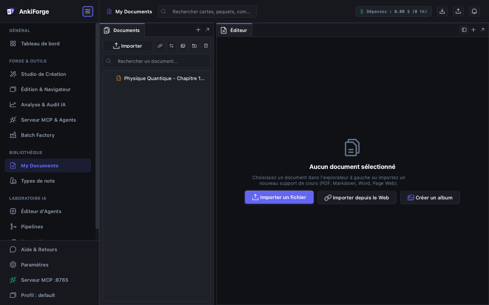
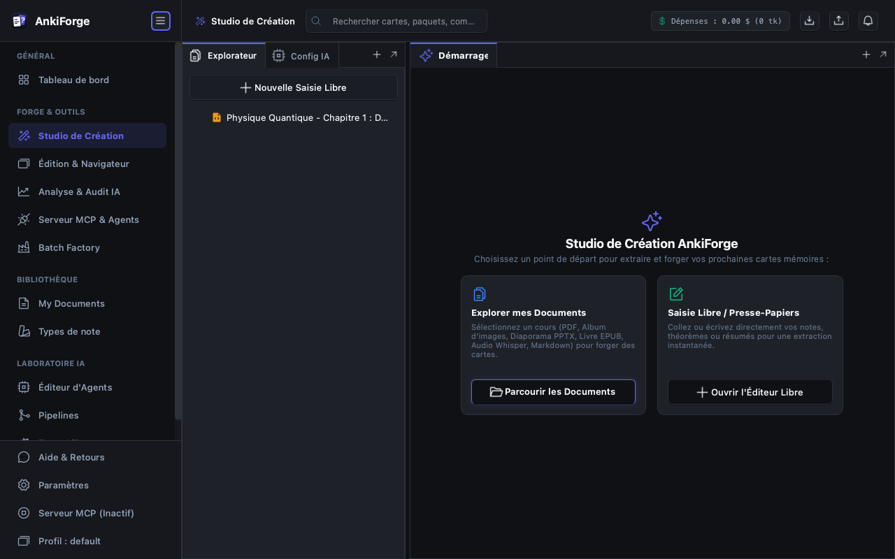

Les vidéos de cours (YouTube, conférences enregistrées) et les mémos audio de travaux dirigés sont denses en explications orales difficiles à ficher manuellement. Ce parcours explique comment les convertir en fiches structurées.

## 1. Importer une vidéo YouTube ou un fichier audio local

1. Ouvrez **My Documents** (<kbd>Alt+7</kbd>).
2. Selon votre support ([Importer Vidéo & Audio](/fr/sources/import-youtube-audio/)) :
   - **Vidéo YouTube** : cliquez sur **Importer depuis le Web** et collez l'URL de la vidéo. AnkiDraft récupère automatiquement les sous-titres officiels ou lance la transcription vocale locale.
   - **Enregistrement audio ou cours local** (`.mp3`, `.wav`, `.m4a`, `.mp4`, `.ogg`) : cliquez sur **Importer un fichier** ou glissez-déposez l'enregistrement. Le moteur local **Whisper** transcrit l'audio sans envoyer vos fichiers sur un serveur tiers.

## 2. Mettre la transcription en chapitres lisibles

Une transcription orale brute contient souvent des hésitations ou des digressions. Avant de générer vos cartes, structurez le texte :

- **Dans le Studio** : sélectionnez le document transcrit et lancez un [scénario de génération](/fr/cards/dag_et_rag/) qui commence par résumer et organiser le texte en chapitres avant de créer les cartes.
- **Avec Claude ou Cursor** : demandez à votre assistant d'appeler `structure_transcript_for_ai` puis `structure_document_sections` pour transformer le texte horodaté en sections claires.

## 3. Découper par thèmes et relire vos cartes

1. Pour générer et relire sur un extrait précis, ouvrez **Studio de Création** (<kbd>Alt+2</kbd>). Pour découper un long cours en plusieurs tâches automatisées, ouvrez **Batch Factory** (<kbd>Alt+6</kbd>) › **Composer le lot…** (<kbd>Ctrl+N</kbd>).
2. Choisissez le modèle (*Basique* ou *Texte à trous*) et le style de rédaction ([Génération IA](/fr/cards/ai-generation/)).
3. Relisez chaque carte dans la file de relecture avant enregistrement pour vérifier les formules ou termes techniques dictés à l'oral.

## 4. Automatiser le tri et la génération (sans clé API)

Si vous travaillez avec Claude Code, Claude Desktop ou Cursor en [mode sans clé API](/fr/workflows/zero-cle-api-agent-mcp/), utilisez cet enchaînement :

- **Outils utilisés** : `structure_transcript_for_ai`, `get_document_outline`, `create_notes_batch`, `begin_staged_bundle`, `commit_staged_bundle`.
- **Prompt type** : *« Prends la transcription brute du document #9, restructure-la avec `structure_transcript_for_ai` (profil didactique en français, horodatages conservés), puis extrais les définitions et mécanismes clés dans un lot `create_notes_batch` vers le paquet `Cours::Neurosciences` pour validation. »*
