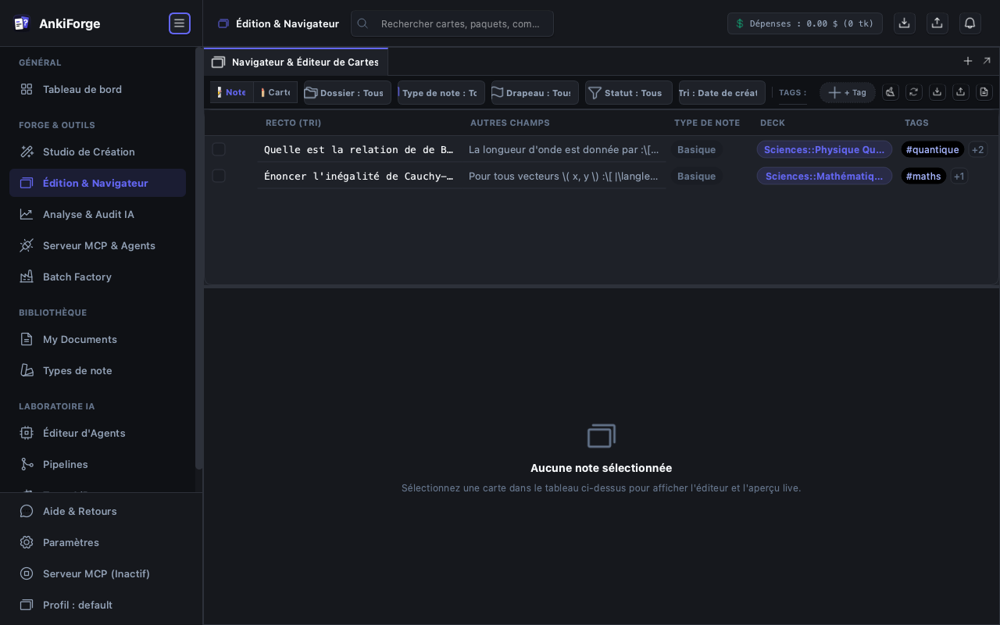

# Parcours Langues & Audio : Vocabulaire et Prononciation TTS

Ce parcours montre comment constituer des paquets de langues vivantes (anglais, japonais, espagnol, allemand, mandarin...) avec des exemples contextualisés, une prononciation audio générée 100 % hors-ligne et une hygiène anti-liant bilingue.

## 1. Préparer votre liste ou importer un support linguistique

Vous pouvez démarrer depuis trois types d'entrées :
- Un **document source** (fiche de grammaire, liste de vocabulaire, article ou sous-titres importés dans **My Documents**).
- Un **paquet Anki existant** importé via <kbd>Ctrl+Shift+I</kbd> ([Importer .apkg / .colpkg](/fr/anki-sync/import-colpkg/)).
- Une **saisie directe** dans **Édition & Navigateur** (<kbd>Alt+3</kbd>).

Pour des cartes durables, privilégiez toujours une **phrase d'exemple courte** sur le recto accompagnée du mot cible plutôt qu'une traduction brute isolée.

## 2. Ajouter la prononciation audio hors-ligne (Kokoro / Piper)

AnkiDraft embarque des moteurs de synthèse vocale neuronale capables de générer des fichiers audio naturels `[sound:tts_xxx.mp3]` sans connexion Internet ni quota cloud ([Synthèse Vocale TTS](/fr/cards/audio-tts/)) :

1. Dans **Paramètres** (<kbd>Ctrl+,</kbd>) > **Audio & TTS**, sélectionnez votre moteur local (**Kokoro-82M** ou **Piper ONNX**) et la voix correspondant à la langue étudiée.
2. **En un clic sur une fiche** : dans **Édition & Navigateur** (<kbd>Alt+3</kbd>), placez le curseur dans le champ contenant la phrase cible et cliquez sur l'icône microphone/haut-parleur pour générer et écouter immédiatement la piste audio.
3. **Par lot sur un paquet entier** : sélectionnez plusieurs notes dans le navigateur et déclenchez la **Génération TTS par lot** pour sonoriser toutes les cartes manquantes en arrière-plan.

## 3. Enrichir, sonoriser et corriger vos cartes de langues via MCP

Un piège classique dans les paquets de langues est la **Pathologie Type 3 (Liant bilingue)** : des cartes qui mélangent deux langues dans le même énoncé ou juxtaposent des traductions littérales sans contexte d'usage. Vous pouvez confier la détection et le nettoyage à votre agent MCP :

- **Sonoriser automatiquement toutes les cartes sans audio d'un paquet** :
  - Outils utilisés : `get_cards_by_deck_or_tag`, `generate_card_audio`, `generate_cards_batch_audio`.
  - Prompt type : *« Liste les notes du paquet `Langues::Japonais` (avec `recursive=True`) qui n'ont pas encore de balise `[sound:...]` et lance `generate_cards_batch_audio` sur le champ Expression avec une voix japonaise. »*
- **Éliminer le liant bilingue et reformuler avec phrases d'exemple** :
  - Outils utilisés : `diagnose_domain_knowledge_gaps`, `propose_card_refactor`.
  - Prompt type : *« Audite le paquet `Langues::Espagnol` avec `diagnose_domain_knowledge_gaps`, repère les cartes présentant du liant bilingue (Type 3) ou une surcharge d'homonymes, et propose via `propose_card_refactor` des cartes courtes avec une phrase contextuelle naturelle. »*

## 4. Exporter avec médias audio normalisés

Appuyez sur <kbd>Ctrl+Alt+E</kbd> pour générer votre `.apkg` : AnkiDraft embarque automatiquement les fichiers audio dédupliqués par signature MD5 afin qu'ils jouent sans accroc sur Anki Desktop, AnkiWeb et AnkiMobile.
