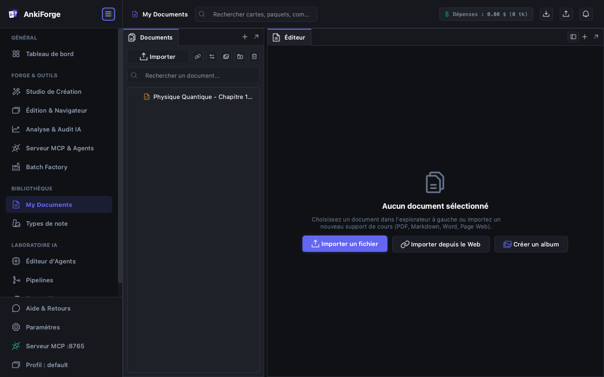
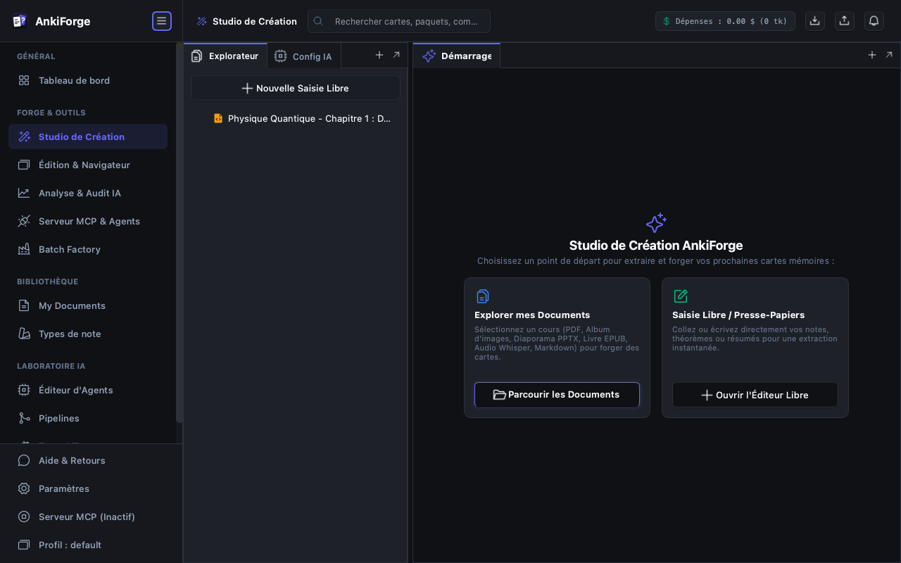
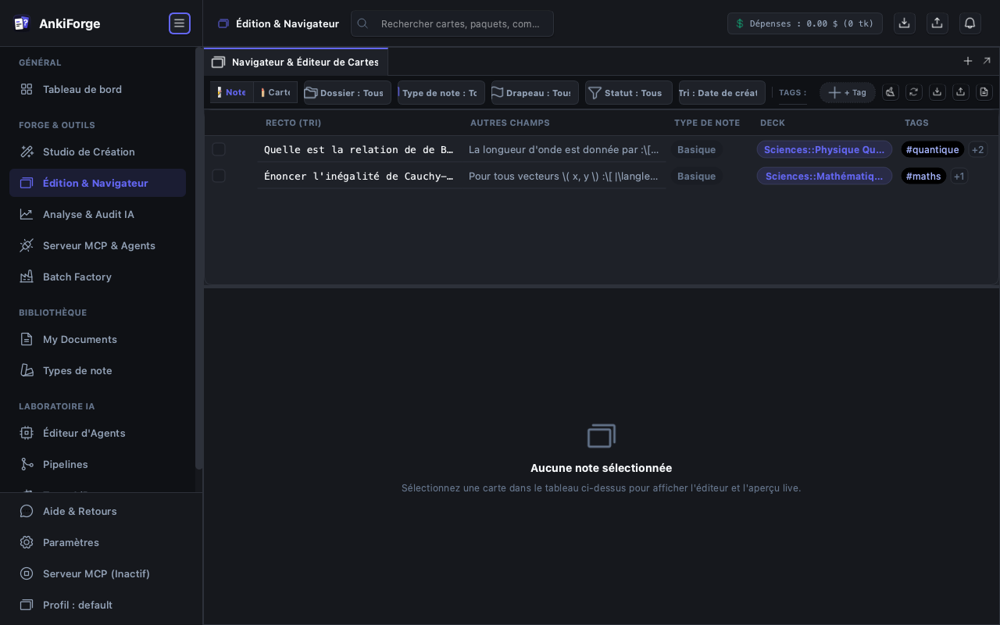

# Parcours Médecine & Sciences : PDF, Formules et Schémas

Ce parcours montre comment transformer un polycopié universitaire dense (anatomie, physiologie, physique, mathématiques) en cartes atomiques fidèles à votre source, avec équations KaTeX et schémas annotés.

## 1. Importer le polycopié PDF avec extraction des figures et formules

1. Ouvrez **My Documents** (<kbd>Alt+7</kbd>) et cliquez sur **Importer un fichier** (ou glissez-déposez votre `.pdf`).
2. Choisissez la méthode adaptée :
   - **Extraction rapide** pour un PDF numérique propre sans formules complexes.
   - **Reconnaissance avancée (OCR Marker)** pour les scans, polycopiés à deux colonnes, tableaux et équations mathématiques converties en LaTeX (`\(...\)` et `\[...\]`).
3. AnkiDraft extrait automatiquement les schémas et figures dans votre bibliothèque média. Consultez [Importer des PDF](/fr/sources/import-pdf/) pour les réglages détaillés.

## 2. Délimiter le périmètre utile (sans supprimer le cours)

Un polycopié de 200 pages contient souvent un avant-propos, une table des matières et une bibliographie qui fausseraient la génération et le taux de couverture.

Dans le sélecteur de portée ([Cibler les chapitres](/fr/sources/scope-and-slices/)) :
- **Écarter** les annexes, remerciements et bibliographies : ces régions sont ignorées par l'IA tout en restant consultables dans votre document.
- **Neutraliser** la table des matières ou les pages de garde : ces conteneurs sont retirés du dénominateur de votre jauge *Smart Coverage* pour afficher votre avancement réel.

## 3. Générer des cartes atomiques et éditer équations ou occlusions

1. Passez dans **Studio de Création** (<kbd>Alt+2</kbd>) ou lancez **Composer le lot…** (*Batch Slice Composer*) pour découper votre sélection par chapitres.
2. Choisissez un modèle adapté (*Basique*, *Cloze / Texte à trous* ou *Image Occlusion*) et le paquet de destination (ex. `Médecine::Cardiologie`).
3. Dans **Édition & Navigateur** (<kbd>Alt+3</kbd>), vérifiez le rendu mathématique KaTeX en direct et créez des textes à trous sur les mots-clés via <kbd>Ctrl+Shift+C</kbd> (<kbd>Cmd+Shift+C</kbd> sur macOS) ou masquez les légendes d'un schéma anatomique ([Éditeur de Notes & KaTeX](/fr/cards/editeur_notes_katex/)).

## 4. Auditer la densité cognitive avant l'export

Ouvrez **Analyse & Audit IA** (<kbd>Alt+4</kbd>) pour exécuter le [Linter Wozniak](/fr/cards/linter_wozniak/) : toute carte dépassant les seuils d'atomicité ou mêlant plusieurs mécanismes physiopathologiques est signalée pour être scindée en un clic, puis exportée via <kbd>Ctrl+Alt+E</kbd> ([Exporter un paquet .apkg](/fr/anki-sync/export-apkg/)).

## 5. Piloter ce parcours via MCP (Claude, Cursor, Antigravity)

Vous préférez piloter la préparation de votre examen depuis Claude Desktop, Claude Code ou Cursor sans consommer de clé API ? Activez le serveur MCP dans **Serveur MCP & Agents** (<kbd>Alt+5</kbd>) et utilisez ces enchaînements :

- **Nettoyer le périmètre avant génération** :
  - Outils utilisés : `get_document_outline`, `exclude_document_region`, `neutralize_document_region`.
  - Prompt type : *« Lis le plan du document #4, neutralise le sommaire et écarte la bibliographie, puis vérifie les chapitres restants. »*
- **Détecter les notions oubliées dans vos paquets et générer le complément** :
  - Outils utilisés : `diagnose_domain_knowledge_gaps`, `search_document`, `create_notes_batch`.
  - Prompt type : *« Lance `diagnose_domain_knowledge_gaps` sur le chapitre Potentiel d'Action de mon cours de Physiologie en croisant tous mes paquets, identifie les lacunes de Type 1 (absences) et crée des cartes atomiques avec formules KaTeX `\( ... \)` soumises au Garde-Fou. »*

> Toutes les propositions d'un agent MCP passent obligatoirement par le **Garde-Fou** avant d'entrer dans votre collection.
