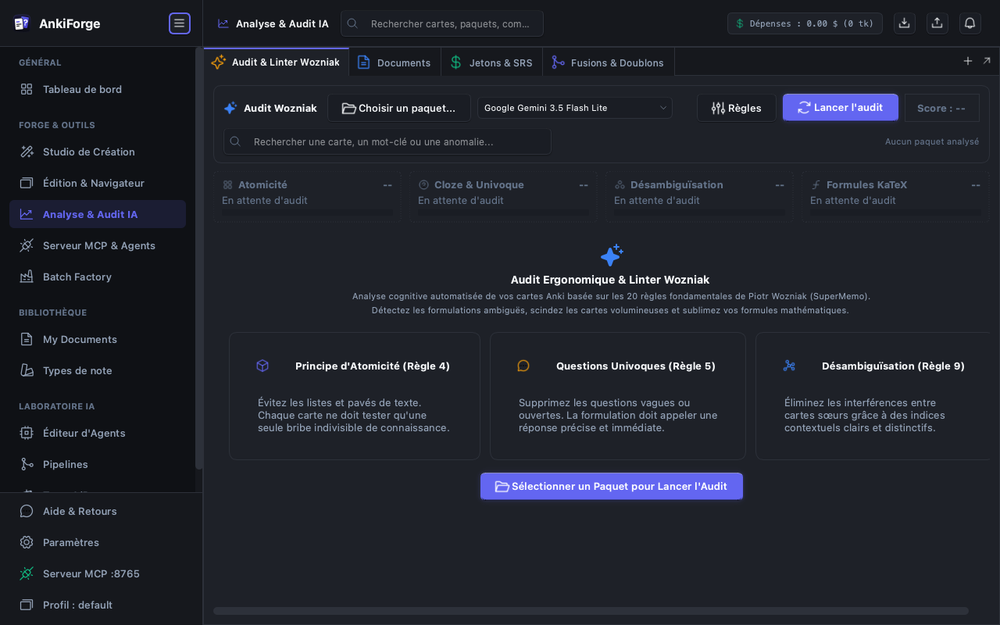
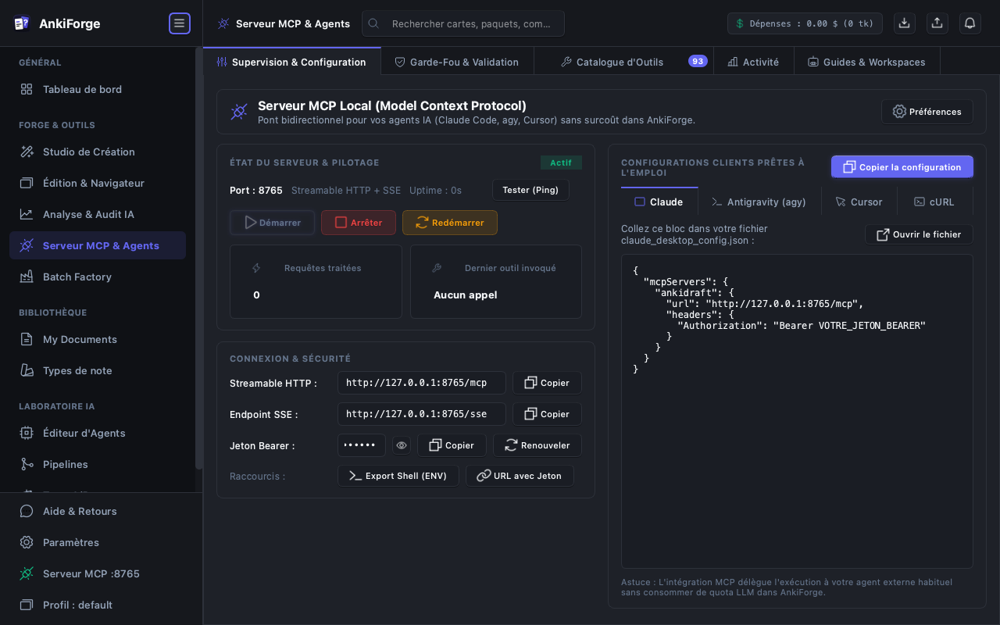

# Parcours Sauvetage Anki : Doublons, Sangsues et Hygiène MCP

Vous révisez un vieux paquet Anki qui accumule des cartes impossibles à mémoriser (« sangsues »), des doublons, des tags incohérents ou des pavés de texte ? Ce parcours vous permet d'assainir votre collection sans jamais perdre votre historique de répétition espacée (FSRS / SM-2).

## 1. Importer votre collection Anki en sécurité (`.colpkg`)

1. Depuis Anki Desktop, exportez une archive complète : **Fichier > Exporter > Collection Anki (`.colpkg`)** en incluant les médias et les données de planification.
2. Dans AnkiDraft, appuyez sur <kbd>Ctrl+Shift+I</kbd> et importez votre `.colpkg` ([Importer .apkg ou .colpkg](/fr/anki-sync/import-colpkg/)).
3. AnkiDraft crée automatiquement une sauvegarde SQLite de secours et sépare strictement votre **Périmètre Collection Anki** de votre **Périmètre Studio** (vos PDF, index RAG et réglages ne sont jamais écrasés).

## 2. Diagnostiquer doublons et cartes surchargées dans l'Hôpital d'Audit

1. Ouvrez **Analyse & Audit IA** (<kbd>Alt+4</kbd>).
2. Dans l'onglet **Audit & Linter Wozniak**, choisissez un paquet et cliquez sur **Lancer l'audit** : les cartes trop longues, ambiguës ou multi-notions reçoivent un diagnostic détaillé ([Linter Wozniak](/fr/cards/linter_wozniak/)).
3. Dans l'onglet **Fusions & Doublons**, repérez les cartes quasi-identiques grâce au moteur natif Levenshtein en C et fusionnez-les proprement.

## 3. Mener une campagne d'hygiène de collection via MCP

Pour traiter des centaines de cartes rapidement et transversalement entre plusieurs paquets, connectez votre client MCP (**Claude**, **Cursor**, **Antigravity**) sur le port `8765` et enchaînez ces quatre étapes :

### Étape A — Traiter les cartes signalées en révision par un drapeau
Pendant vos révisions quotidiennes dans Anki, marquez simplement les cartes pénibles d'un drapeau (Rouge = à scinder, Orange = à vérifier), puis réimportez votre `.colpkg` dans AnkiDraft :
- **Outils MCP** : `get_flagged_cards`, `get_note_full_profile_360`, `set_card_flag`.
- **Prompt** : *« Récupère toutes mes cartes marquées d'un drapeau rouge via `get_flagged_cards`, analyse pourquoi je les rate avec `audit_card_wozniak` et propose une refonte atomique pour chacune. »*

### Étape B — Décloisonner et diagnostiquer les 3 pathologies d'un domaine
- **Outils MCP** : `diagnose_domain_knowledge_gaps`, `diagnose_deck_weaknesses`, `audit_deck_wozniak`, `find_duplicate_cards`.
- **Prompt** : *« Lance `diagnose_domain_knowledge_gaps` sur le thème Physiologie Rénale en incluant tous mes paquets : repère les cartes orphelines qui parlent déjà du sujet, les manques de couverture (Type 1), les cartes non atomiques (Type 2) et le liant bilingue (Type 3). »*

### Étape C — Nettoyer les tags et supprimer les cartes vides
- **Outils MCP** : `audit_tag_hygiene`, `merge_tag_clusters`, `list_empty_cards`, `delete_empty_cards`.
- **Prompt** : *« Audite la cohérence de mes tags avec `audit_tag_hygiene`, propose la fusion des variantes quasi-identiques via `merge_tag_clusters` et liste les cartes au recto vide avec `list_empty_cards`. »*

### Étape D — Scinder et reformuler par lots sous protection du Garde-Fou
- **Outils MCP** : `begin_staged_bundle`, `propose_card_split`, `propose_card_refactor`, `propose_cards_batch_refactor`, `commit_staged_bundle`.
- **Prompt** : *« Ouvre un lot groupé (`begin_staged_bundle`), scinde les 8 cartes dépassant 40 mots avec `propose_card_split` en 2 à 3 cartes atomiques chacune, reformule les énoncés flous via `propose_card_refactor` et clôture le lot avec `commit_staged_bundle`. »*

## 4. Valider au Garde-Fou et ré-exporter sans perte SRS

1. Ouvrez **Serveur MCP & Agents** (<kbd>Alt+5</kbd>) > **Garde-Fou & Validation** et vérifiez visuellement chaque scission et reformulation Avant / Après.
2. Cliquez sur **Appliquer** pour valider le lot dans AnkiDraft.
3. Exportez le paquet assaini via <kbd>Ctrl+Alt+E</kbd> (ou l'outil MCP `export_deck_apkg`) puis importez le `.apkg` dans Anki : grâce aux identifiants GUID stables et au [Smart Merge](/fr/anki-sync/synchro_smart_merge/), vos nouvelles formulations remplacent les anciennes sans réinitialiser votre progression FSRS.
