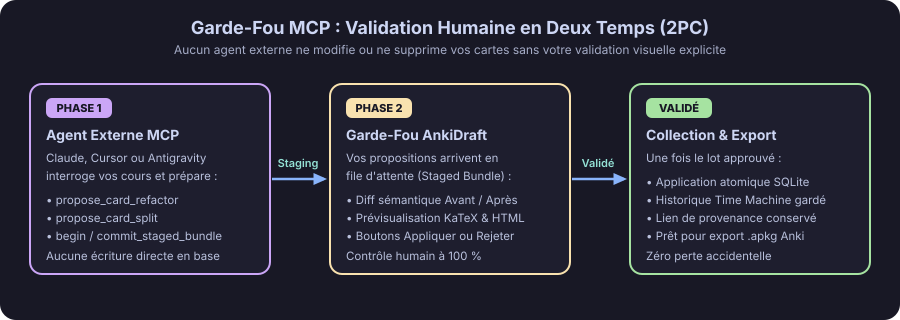
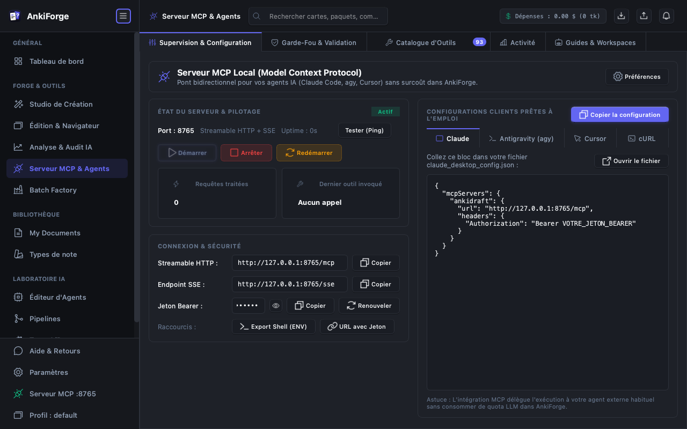

# Parcours Zéro Clé API : Piloter AnkiDraft avec Claude ou Cursor

Vous utilisez déjà **Claude Desktop**, **Claude Code**, **Cursor** ou **Antigravity** ? Grâce au protocole standard **MCP (Model Context Protocol)** intégré à AnkiDraft, vous pouvez créer des cartes, analyser vos cours et assainir vos paquets **sans aucune clé API payante** et sous protection permanente du **Garde-Fou**.

## 1. Démarrer le serveur MCP et copier la configuration en 1 clic

1. Ouvrez **Serveur MCP & Agents** (<kbd>Alt+5</kbd>) dans la barre latérale.
2. Vérifiez que le serveur local est **Actif** sur le port `8765` (sinon cliquez sur **Démarrer**).
3. Dans le panneau de droite **Configurations Clients Prêtes à l'Emploi**, sélectionnez votre assistant (**Claude**, **Antigravity**, **Cursor** ou **cURL**) et cliquez sur **Copier la configuration** (ou **Ouvrir le fichier**).
4. Collez le bloc JSON (avec l'endpoint `http://127.0.0.1:8765/mcp` et votre jeton Bearer) dans la configuration de votre client IA et redémarrez-le.

## 2. Cinq cas d'usage MCP concrets (prompts prêts à l'emploi)

### Cas A — Générer des cartes ancrées dans un chapitre de cours
- **Outils MCP** : `search_document`, `get_document_outline`, `begin_staged_bundle`, `create_notes_batch`, `commit_staged_bundle`.
- **Prompt** : *« Consulte le plan du document #3, lis les sections sur la régulation glycémique avec `search_document`, puis prépare un lot groupé (`begin_staged_bundle` + `create_notes_batch` + `commit_staged_bundle`) de 12 cartes atomiques en syntaxe KaTeX dans le paquet `Biochimie::Métabolisme`. »*

### Cas B — Déposer une fiche de synthèse externe comme source d'autorité
- **Outils MCP** : `write_mcp_artifact`, `ingest_authority_source`, `reindex_document`.
- **Prompt** : *« Rédige une synthèse structurée en Markdown sur les mécanismes de défense immunitaire à partir de mes notes, enregistre-la via `write_mcp_artifact` puis indexe-la dans AnkiDraft avec `ingest_authority_source` pour que mes futures cartes y soient tracées. »*

### Cas C — Créer ou moderniser un modèle de carte (Note Type & CSS)
- **Outils MCP** : `list_note_types`, `get_note_type_details`, `propose_note_type_refactor`, `propose_css_tune`, `preview_card_render`.
- **Prompt** : *« Inspecte le modèle `Médecine Cloze` avec `get_note_type_details`, améliore le contraste des indices en mode sombre via `propose_css_tune`, vérifie le rendu HTML avec `preview_card_render` et soumets `propose_note_type_refactor` au Garde-Fou. »*

### Cas D — Piloter un pipeline DAG en mode délégué MCP
- **Outils MCP** : `list_pipelines`, `trigger_pipeline_run`, `provide_pipeline_step_content`.
- **Prompt** : *« Liste mes pipelines avec `list_pipelines`, lance le pipeline d'extraction #2 en mode délégué via `trigger_pipeline_run`, produis le contenu de chaque étape suspendue via `provide_pipeline_step_content` et envoie les cartes finales au Garde-Fou. »*

### Cas E — Assainir et restructurer un paquet existant
- **Outils MCP** : `get_flagged_cards`, `diagnose_domain_knowledge_gaps`, `propose_card_split`, `propose_card_refactor`.
- **Prompt** : *« Récupère mes cartes marquées d'un drapeau rouge via `get_flagged_cards` et scinde les cartes trop denses avec `propose_card_split`. »* (Voir le guide dédié [Sauvetage & Hygiène Anki via MCP](/fr/workflows/sauvetage-et-hygiene-anki-mcp/)).

## 3. Relire et appliquer dans le Garde-Fou (Two-Phase Commit)

Aucune écriture n'est appliquée silencieusement :
1. Ouvrez l'onglet **Garde-Fou & Validation** dans **Serveur MCP & Agents** (<kbd>Alt+5</kbd>).
2. Inspectez le **Diff Avant / Après**, la prévisualisation HTML/KaTeX et l'impact des suppressions ou scissions.
3. Cliquez sur **Appliquer** pour enregistrer le lot dans SQLite de manière atomique, ou sur **Rejeter** pour annuler sans trace.
